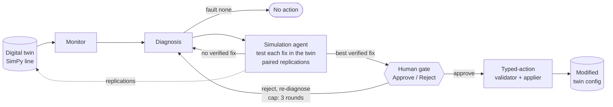

# Agentic Digital Twin for Shop-Floor Performance

A research prototype. A multi-agent LLM system watches a simulated 5-station production line (a SimPy digital twin), diagnoses throughput losses, **tests candidate fixes inside the twin**, and only then recommends the best one to a human supervisor. Nothing is applied without human approval.

Core principle: **verify before act.**

Research questions:

- **RQ1** Does a multi-agent design find the true bottleneck more accurately than a single LLM agent?
- **RQ2** Does simulating fixes before recommending them improve recommendation quality?
- **RQ3** How often does the human gate catch a harmful or invalid recommendation?

Everything is simulated. There is no real PLC/OPC UA, computer vision, multi-plant scheduling or proprietary data.

> **Status of the numbers.** The committed `results/` and `docs/RESULTS.md` were produced in **mock mode** (scripted stand-ins for the LLM roles). They validate the pipeline and the metrics but cannot answer RQ1 and only partially answer RQ2 and RQ3. Run with a real key for LLM results (see below).

## Architecture



Agents may only propose three typed actions (`AddBuffer`, `RebalanceTask`, `ChangeMaintenance`). Every action is schema- and constraint-checked before it is simulated or applied; rejections are logged with a reason. Details: [docs/ARCHITECTURE.md](docs/ARCHITECTURE.md).

## Quickstart

Requires Python 3.11+ (override the interpreter with `make setup PYTHON=python3.12`).

```bash
make setup            # creates .venv and installs dependencies
make test             # full test suite, fully offline (mock mode)
make run-experiments  # all systems x scenarios x seeds -> results/ and docs/RESULTS.md
make dashboard        # Streamlit supervisor dashboard
```

### Mock mode (default, no API key)

With no `ANTHROPIC_API_KEY`, every LLM role is answered by deterministic rule-based handlers in `src/agents/mock_roles.py`. Tests never need a key. All outputs are labelled MOCK.

### Real LLM mode

```bash
cp .env.example .env
# edit .env: ANTHROPIC_API_KEY=sk-ant-...   LLM_MODEL=claude-haiku-5-5   LLM_MODE=real
make run-experiments
```

`LLM_MODEL` defaults to a small, cheap model. Responses are cached on disk in `results/llm_cache/` keyed by (model, prompt), so reruns are free and reproducible. Token and step counts are recorded per run. The judge for explanation quality also runs through the same client.

### Reproduce the experiments

```bash
make run-experiments                                   # 10 seeds
.venv/bin/python -m src.eval.runner --seeds 30 --bad-rate 0.5
```

Writes to `results/`: `runs.csv`, `gate_reviews.csv`, summary tables with 95% CIs, grouped bar charts in `results/plots/`, `human_review_template.csv` (blind template for 2-3 human reviewers, key in `human_review_key.csv`), and `summary.md`, which answers RQ1-RQ3 from the data and lists limitations. `docs/RESULTS.md` is a copy.

Systems compared on identical seeded scenarios: **rule-based**, **single agent** (no simulation), **multi-agent without simulation** (ablation), **multi-agent** (full).

### Dashboard

`make dashboard` opens the supervisor view: pick a scenario and seed, watch the KPI charts and Monitor/Diagnosis findings, inspect the table of simulated fixes (before/after throughput), then **Approve** or **Reject**. Rejection sends the case back to Diagnosis. The trace and token usage are shown below. A 5-minute walkthrough is in [docs/DEMO.md](docs/DEMO.md).

## Project structure

```
src/
  twin/          SimPy line, stations, buffers, breakdowns, KPI collector, event log
  scenarios/     seeded fault scenarios with ground-truth labels
  actions/       typed action schema, constraint validator, applier
  agents/        monitor, diagnosis, simulation, supervisor gate, LangGraph graph, mock roles
  baselines/     rule_based.py, single_agent.py
  llm/           client with disk cache, token counting, retries, JSON validation, mock mode
  eval/          metrics, runner, analysis, plots, judge, report
  dashboard/     Streamlit app
tests/           twin validity, actions, LLM layer, graph routing, baselines, metrics, dashboard
docs/            ARCHITECTURE.md, ASSUMPTIONS.md, RESULTS.md, DEMO.md
results/         CSVs, plots, summary.md, (cached LLM runs, git-ignored)
```

## Limitations

- The twin is both what the agents observe and the verifier they use, so there is no sim-to-real gap. Verified gains are real inside the simulation by definition.
- Five synthetic scenarios with illustrative line parameters; ground truth is exact only because faults are seeded.
- The batch-mode human gate is a rule-based simulation of a supervisor that sees only the evidence presented. Real supervisors need real data (use the dashboard).
- Mock-mode results do not measure LLM quality. The judge in mock mode is a lexical rubric, and human explanation scores must be collected separately.
- Small seed counts give wide confidence intervals.

See [docs/ASSUMPTIONS.md](docs/ASSUMPTIONS.md) for every modelling choice and parameter source.
