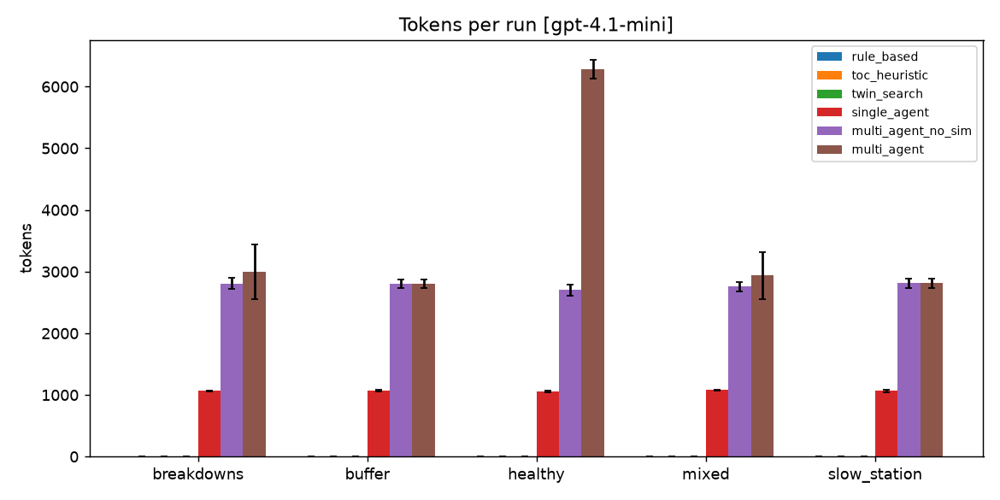
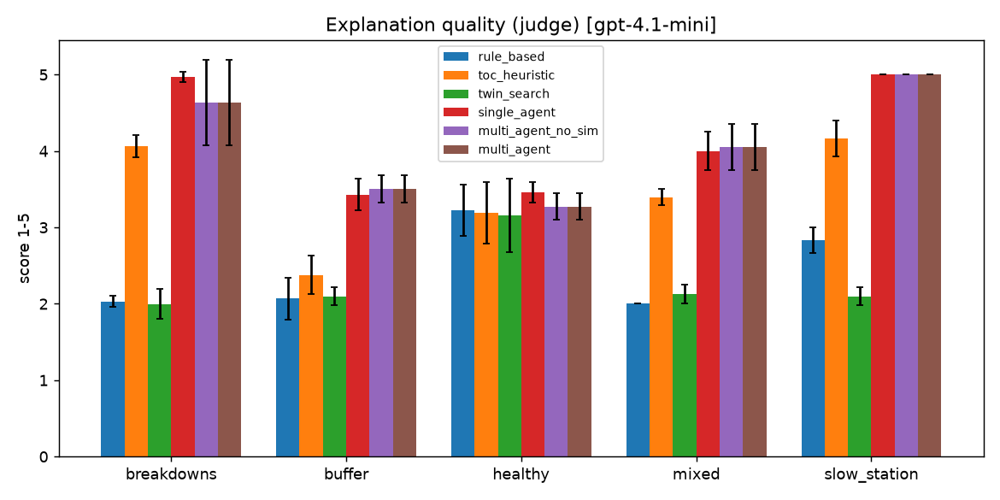
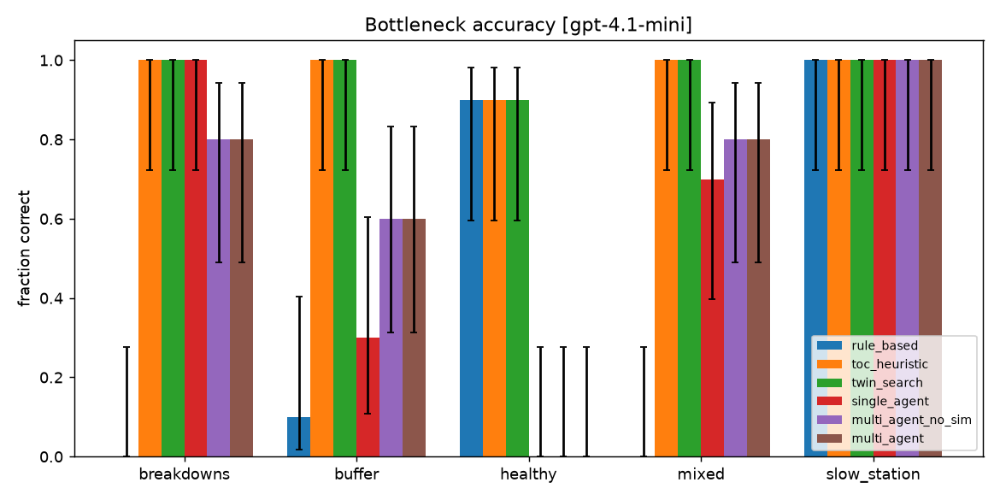
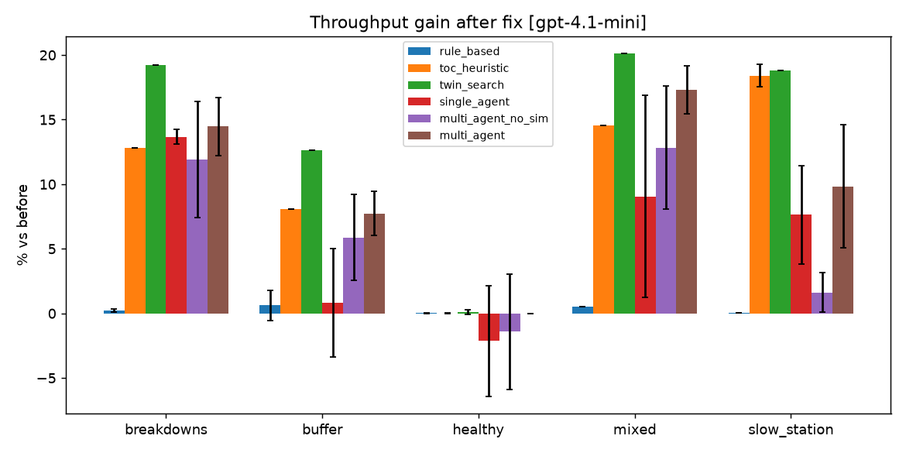
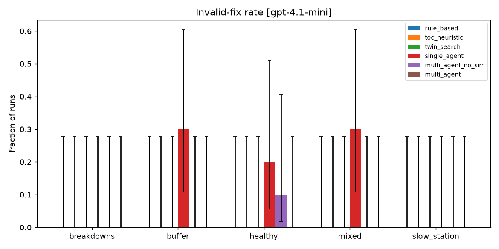
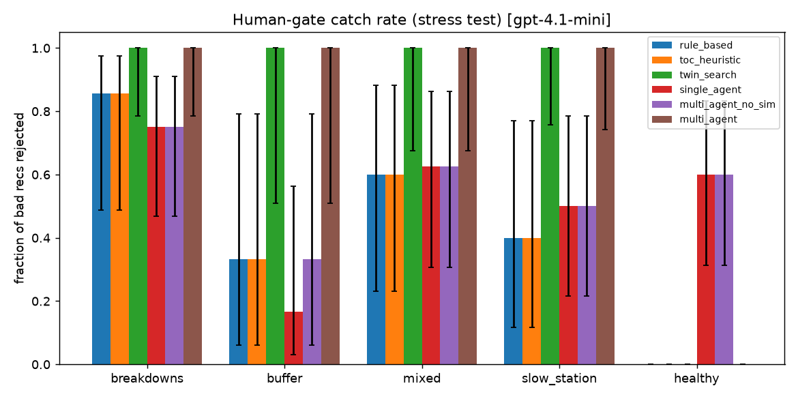

# Final Project Report: Agentic Digital Twin for Shop-Floor Performance

**Results basis:** real LLM run, `gpt-4.1-mini` (OpenAI Chat Completions, JSON mode, default sampling), 10 seeds per cell, generated 2026-11-15. Source data: `results_real/` (`runs.csv`, `gate_reviews.csv`, `summary_by_system*.csv`, `plots/`, `run_meta.json`). The mock-mode results in `results/` and `docs/RESULTS.md` validate the pipeline only and are **not** used for any claim below.

---

## 1. Summary

A multi-agent LLM system monitors a simulated 5-station production line (SimPy digital twin), diagnoses throughput loss, **tests candidate fixes inside the twin**, and recommends one to a human supervisor only if the twin shows a gain. Principle: **verify before act**.

Headline findings (real LLM, fault scenarios, 10 seeds):

1. **Verification works.** Multi-agent with simulation never applied an ineffective or harmful fix (0% [0, 8.8]) and never acted on the healthy line (0% false alarms). Without the Simulation step the same agents applied ineffective fixes in 40% of runs and acted on the healthy line in 100% of runs. Paired throughput-gain difference with vs without simulation: **+4.28 pp** (95% CI [+2.75, +5.94]).
2. **Multi-agent vs single agent on diagnosis: no detectable difference.** 80.0% vs 75.0% bottleneck accuracy, paired difference +5.0 pp, CI [-10, +20]. Multi-agent costs about 2.7x the tokens (2888 vs 1069) and 3.1x the LLM steps.
3. **The gate only catches harmful-but-valid fixes when it is shown trustworthy twin evidence.** The default simulated gate caught 100% of bad recommendations from twin-verified systems but 0% of harmful-but-valid fixes from systems without twin evidence. With forged evidence the trusting gate dropped to 63%; an independent re-simulating gate restored 100% in every system.
4. **The LLM is not what produces the gain.** Exhaustive non-LLM twin search (`twin_search`) gained more throughput than multi-agent (17.7% vs 12.3%, paired difference -5.35 pp, CI [-6.76, -3.95]), and a simple Theory-of-Constraints heuristic matched it statistically (13.5% vs 12.3%). What the multi-agent system adds is a diagnosis and a human-readable explanation, plus lower cost per run in twin simulations.

All findings are inside the simulation. The twin is also the world and the verifier, so there is no sim-to-real gap. See Limitations (section 9).

---

## 2. Problem and research questions

A production supervisor needs to know why output dropped and what to change, without trusting an unverified AI suggestion. This prototype tests whether a verify-before-act design improves recommendation quality.

- **RQ1** Does a multi-agent design find the true bottleneck more accurately than a single LLM agent?
- **RQ2** Does simulating fixes before recommending them improve recommendation quality?
- **RQ3** How often does the human gate catch a harmful or invalid recommendation?
- **Extra** Does the multi-agent system beat strong non-LLM baselines? Does the gate need to trust presented evidence?

Out of scope: real PLC/OPC UA, computer vision, multi-plant scheduling, proprietary data. Everything is simulated.

---

## 3. System design

### 3.1 Digital twin (`src/twin`)
- `StationConfig` / `LineConfig` (pydantic; stations 1-based; `buffer_after` on station *i* is the buffer between *i* and *i+1*).
- `ProductionLine` (SimPy): each station pulls from the upstream buffer, processes, pushes downstream (blocking after service). Independent seeded RNG streams per station and purpose give **common random numbers** across configurations.
- KPIs from 60 s cumulative snapshots: throughput, per-station utilization / blocked / starved / down fractions, breakdown counts, mean buffer levels, WIP.
- Structured event log: `breakdown_start`, `breakdown_end`, `blocked_end`, `starved_end`.
- Healthy line: about 410 units per 8 h shift.

### 3.2 Scenarios (`src/scenarios`)
Each scenario carries `GroundTruth(station, fault_type)`; agents never see it.

| Scenario | Definition | Truth |
|---|---|---|
| healthy | no fault | none |
| slow_station | station 2 at 95 s | station 2 |
| breakdowns | station 4 MTBF 900 s / MTTR 300 s | station 4 |
| buffer | buffer after station 2 capacity 1, station 2 MTBF 1500 / MTTR 360, station 3 CV 0.5 | station 2 (owns the undersized buffer) |
| mixed | station 4 MTBF 800 / MTTR 400 plus station 2 at 75 s (secondary) | station 4 (lowest analytic effective capacity; asserted by tests) |

### 3.3 Typed-action safety layer (`src/actions`)
Agents can only propose `AddBuffer`, `RebalanceTask`, `ChangeMaintenance` (pydantic, `extra="forbid"`, discriminated on `type`). `validate_and_apply` checks constraints against the current config, logs every rejection with its reason, and returns a modified deep copy. All systems, baselines, and the human gate go through it.

| Action | Constraint |
|---|---|
| AddBuffer | stations 1..4, add 1..5 slots, total capacity capped at 12 |
| RebalanceTask | adjacent stations only, fraction in (0, 0.30], total work conserved |
| ChangeMaintenance | only stations with a failure model; MTBF multiplier in [1, 2], MTTR multiplier in [0.5, 1]; no-ops rejected |

### 3.4 Agent graph (`src/agents/graph.py`, LangGraph)
```
START -> monitor -> diagnosis -+-> (fault none) -------------------------> finalize
                     ^         +-> candidates (Simulation) -+-> gate -+-> apply -> finalize
                     +---- re-diagnose (no viable fix) -----+         |
                     +---- re-diagnose (gate rejected) ---------------+
                            (cap: 3 diagnosis rounds -> finalize)
```
1. **Monitor** reads one simulated shift (KPIs plus event summary, never the scenario label) and flags anomalies.
2. **Diagnosis** names bottleneck station and fault type with explanation and confidence; after a rejection it receives feedback and must revise.
3. **Simulation** validates LLM-proposed candidates (up to 5), runs each valid one over 8 seeded replications paired with the unmodified line, and passes only fixes with mean gain >= 2% and one-sided paired t-test p < 0.05. Only the top passing fix is recommended.
4. **Supervisor gate**: batch mode uses `SimulatedApprover`; the dashboard uses a real person via `interrupt_before=["gate"]` and `submit_human_decision`.

State is plain dicts (checkpointable) with reducer-merged `trace`, `gate_log`, `diagnoses`, `action_rejections`. Only an approved fix is applied (re-validated).

### 3.5 Gate (`src/agents/gate.py`)
- `SimulatedApprover`: sees only presented evidence. With twin evidence it approves iff gain >= 2%; without, it can only check constraint validity. Can inject bad recommendations (invalid: buffer after last station; harmful: move 30% of a neighbour's work onto the diagnosed bottleneck).
- `IndependentApprover`: ignores presented evidence, validates, then re-simulates on its own seeds (3000+) with the Simulation agent's test.

### 3.6 Dashboard (`src/dashboard`)
Streamlit supervisor UI: runs the pipeline to the gate, shows KPIs, findings, candidate table with CIs and p-values, trace, and Approve/Reject buttons. Rejection triggers re-diagnosis. Tested with `streamlit.testing.v1.AppTest`.

### 3.7 LLM layer
Disk cache keyed by (model, system prompt, user prompt), token counting, exponential-backoff retries (1, 2, 4, 8 s), one JSON repair re-ask. Provider selected explicitly: Anthropic by default when a key is set, OpenAI only with `LLM_PROVIDER=openai`. A "step" is one LLM call including cache hits and repair re-asks. Mock mode (rule-based) is used by the test suite and is labelled MOCK everywhere.

---

## 4. Systems compared

All six face the same gate, validator, and 3-round cap, and act only on a >= 5% throughput drop.

| System | Description |
|---|---|
| `rule_based` | Highest busy-fraction station; add 3 buffer slots. No LLM, no twin. Deliberately naive floor. |
| `toc_heuristic` | Theory-of-Constraints rules on observed KPIs only. Thresholds fixed a priori, not tuned. No LLM, no twin. |
| `twin_search` | No LLM, no diagnosis. Enumerates the full typed action grid, tests each in the twin (about 496 simulations per fault run), offers best verified fix to the gate. |
| `single_agent` | One LLM call returns diagnosis plus one action; no simulation; receives rejection feedback and may retry. |
| `multi_agent_no_sim` | Full graph with Simulation replaced by "take first constraint-valid proposal, unverified" (ablation). |
| `multi_agent` | Full verify-before-act graph. |

---

## 5. Experimental protocol

- **Grid:** 6 systems x 5 scenarios x 10 seeds (observation seeds 1..10).
- **Experiments:** `clean` (no injection; RQ1, RQ2), `stress` (bad recommendation injected with probability 0.5 per review; RQ3), plus four gate arms: `clean_indep`, `stress_indep`, `stress_forged`, `stress_forged_indep`. Injection draws are paired across systems.
- **Settings:** `n_reps` 8, `min_gain_pct` 2.0, `alpha` 0.05, `max_iterations` 3, `max_candidates` 5, Simulation seeds 1000+.
- **Seed separation:** observation 1..N, reference 100..104, Simulation agent 1000+, scoring 2000+ (20 replications), independent gate 3000+. Disjoint by construction.
- **Metrics:** bottleneck accuracy (first diagnosis; on healthy, "no fault" is correct); fault-type accuracy (`mixed` accepts breakdowns or slow_station); throughput gain on independent replications (0 when nothing applied); invalid/harmful rate (harmful = independent gain below -1%); ineffective-fix rate (applied fix with gain below 2%); gate catch rate; LLM steps and tokens; explanation quality (LLM judge, 1-5).
- **Statistics:** Wilson CIs for proportions, t-intervals for means, paired bootstrap (2000 resamples) for system differences over the 40 fault (scenario, seed) pairs.

---

## 6. Results (real LLM, gpt-4.1-mini)

### 6.1 Overall, fault scenarios, clean experiment (95% CIs)

| System | Bottleneck acc. % | Fault-type acc. % | Throughput gain % | Invalid/harmful % | Ineffective % | LLM steps | Tokens | Explanation (1-5) |
|---|---|---|---|---|---|---|---|---|
| rule_based | 27.5 [16.1, 42.8] | n/a | 0.4 [0.1, 0.6] | 0.0 | 97.5 [87.1, 99.6] | 0 | 0 | 2.23 |
| toc_heuristic | 100.0 [91.2, 100] | 75.0 [59.8, 85.8] | 13.5 [12.3, 14.7] | 0.0 | 0.0 | 0 | 0 | 3.50 |
| twin_search | 100.0 [91.2, 100] | n/a | 17.7 [16.7, 18.6] | 0.0 | 0.0 | 0 | 0 | 2.08 |
| single_agent | 75.0 [59.8, 85.8] | 75.0 [59.8, 85.8] | 7.8 [5.2, 10.4] | 15.0 [7.1, 29.1] | 25.0 [14.2, 40.2] | 1.0 | 1069 | 4.35 |
| multi_agent_no_sim | 80.0 [65.2, 89.5] | 72.5 [57.2, 83.9] | 8.1 [5.9, 10.2] | 0.0 | 40.0 [26.3, 55.4] | 3.0 | 2795 | 4.30 |
| multi_agent | 80.0 [65.2, 89.5] | 72.5 [57.2, 83.9] | 12.3 [10.6, 14.1] | 0.0 | 0.0 [0, 8.8] | 3.1 | 2888 | 4.30 |





### 6.2 Bottleneck accuracy (%) by scenario

| System | breakdowns | buffer | healthy | mixed | slow_station |
|---|---|---|---|---|---|
| rule_based | 0 | 10 | 90 | 0 | 100 |
| toc_heuristic | 100 | 100 | 90 | 100 | 100 |
| twin_search | 100 | 100 | 90 | 100 | 100 |
| single_agent | 100 | 30 | 0 | 70 | 100 |
| multi_agent_no_sim | 80 | 60 | 0 | 80 | 100 |
| multi_agent | 80 | 60 | 0 | 80 | 100 |

The three LLM systems score 0% on the healthy line because they always report a fault; only simulation prevents that from turning into an action (6.5). The `buffer` scenario is the hardest for the LLM systems (30-60%).



### 6.3 Throughput gain (%) by scenario

| System | breakdowns | buffer | healthy | mixed | slow_station |
|---|---|---|---|---|---|
| rule_based | 0.2 | 0.6 | 0.0 | 0.5 | 0.1 |
| toc_heuristic | 12.8 | 8.1 | 0.0 | 14.6 | 18.4 |
| twin_search | 19.2 | 12.7 | 0.1 | 20.1 | 18.8 |
| single_agent | 13.7 | 0.8 | -2.1 | 9.1 | 7.6 |
| multi_agent_no_sim | 11.9 | 5.9 | -1.4 | 12.8 | 1.6 |
| multi_agent | 14.5 | 7.7 | 0.0 | 17.3 | 9.8 |



### 6.4 Invalid/harmful and ineffective fixes
- Invalid/harmful: only `single_agent` produced any (buffer 30%, healthy 20%, mixed 30%), plus `multi_agent_no_sim` on healthy (10%). `multi_agent` produced none.
- Ineffective (applied fix with independent gain below 2%): `multi_agent` 0% in every scenario; `multi_agent_no_sim` 100% on healthy, 80% on slow_station; `single_agent` 100% on healthy, 70% on buffer; `rule_based` about 100% on every fault scenario.



### 6.5 False-alarm actions on the healthy line

| System | % of runs that acted |
|---|---|
| rule_based / toc_heuristic / twin_search | 10 |
| single_agent | 100 |
| multi_agent_no_sim | 100 |
| multi_agent | **0** |

### 6.6 Gate catch rate, stress experiment

| System | Bad recs at gate | Caught % [95% CI] | Harmful-but-valid caught | Invalid caught |
|---|---|---|---|---|
| rule_based | 20 | 60.0 [38.7, 78.1] | 0% (n=8) | 100% (n=12) |
| toc_heuristic | 20 | 60.0 [38.7, 78.1] | 0% (n=8) | 100% (n=12) |
| twin_search | 38 | 100 [90.8, 100] | 100% (n=16) | 100% (n=22) |
| single_agent | 44 | 56.8 [42.2, 70.3] | 0% (n=19) | 100% (n=25) |
| multi_agent_no_sim | 41 | 61.0 [45.7, 74.3] | 0% (n=16) | 100% (n=25) |
| multi_agent | 37 | 100 [90.6, 100] | 100% (n=16) | 100% (n=21) |

Share of stress runs where a bad fix was actually applied: rule_based 20%, toc_heuristic 20%, twin_search 0%, single_agent 38%, multi_agent_no_sim 30%, multi_agent 0%.



### 6.7 Gate trust: independent re-simulation

Catch rate over bad recommendations reaching the gate:

| System | honest, trusting | honest, independent | forged, trusting | forged, independent |
|---|---|---|---|---|
| rule_based | 60% (20) | 100% (20) | 60% (20) | 100% (20) |
| toc_heuristic | 60% (20) | 100% (20) | 60% (20) | 100% (20) |
| twin_search | 100% (38) | 100% (38) | 63% (30) | 100% (38) |
| single_agent | 57% (44) | 100% (75) | 57% (44) | 100% (75) |
| multi_agent_no_sim | 61% (41) | 100% (70) | 61% (41) | 100% (70) |
| multi_agent | 100% (37) | 100% (38) | 63% (30) | 100% (38) |

Cost of independence on good fixes (clean, fault scenarios):

| System | Gain %, trusting | Applied | Gain %, independent | Applied |
|---|---|---|---|---|
| rule_based | 0.4 | 100% | 0.1 | 2% |
| toc_heuristic | 13.5 | 100% | 13.5 | 100% |
| twin_search | 17.7 | 100% | 17.7 | 100% |
| single_agent | 7.8 | 100% | 9.7 | 82% |
| multi_agent_no_sim | 8.1 | 100% | 10.2 | 88% |
| multi_agent | 12.3 | 100% | 12.3 | 100% |

The independent gate raised the mean gain of the unverified LLM systems (it rejects their bad fixes) and left twin-verified systems unchanged. It costs 2 x `n_reps` extra twin simulations per review.

---

## 7. Answers to the research questions

**RQ1: multi-agent vs single agent bottleneck accuracy.** Multi-agent 80.0 [65.2, 89.5]% vs single agent 75.0 [59.8, 85.8]%. Paired difference +5.00 pp, CI [-10.00, +20.00], n=40: **no detectable difference.** Both beat rule-based by +52.5 pp (CI [+37.5, +67.5]). Multi-agent cost: 3.10 steps and 2888 tokens vs 1.00 and 1069. Answer: not shown at this sample size; the multi-agent design is not a more accurate diagnoser here, and it is more expensive.

**RQ2: does simulating fixes help?** Yes. With vs without simulation (same agents): gain +4.28 pp (CI [+2.75, +5.94]); ineffective-fix rate -0.40 (CI [-0.55, -0.25]); invalid/harmful rate no detectable difference (0 vs 0 in the clean experiment). Versus the single agent: +4.54 pp (CI [+2.11, +7.10]). Caveat: Simulation picks the best-measured candidate from the same proposal list, so part of the gain is selection among candidates, not better proposals.

**Versus strong non-LLM baselines.**

| Baseline | Gain, multi-agent minus baseline | Ineffective-fix rate |
|---|---|---|
| toc_heuristic | -1.13 pp (CI [-3.05, +0.71]): no detectable difference | +0.00: no detectable difference |
| twin_search | -5.35 pp (CI [-6.76, -3.95]): lower | +0.00: no detectable difference |

Exhaustive twin search beats multi-agent on throughput, so on this 5-station grid the proposer's shortlist (default 5 candidates), not the twin, limits the multi-agent result. TOC matches it statistically. The multi-agent system's remaining value is the diagnosis and explanation (explanation score 4.30 vs 2.08 for twin_search and 3.50 for TOC), and about 3 LLM calls per run instead of about 496 twin simulations.

**RQ3: gate catch rate.** Overall: twin_search 100%, multi_agent 100%, multi_agent_no_sim 61%, rule_based 60%, toc_heuristic 60%, single_agent 57%. Invalid recommendations were caught 100% of the time everywhere (the validator is deterministic). Harmful-but-valid fixes were caught 100% only when twin evidence was shown. This is a property of the simulated approver's design, not an independent finding. A real supervisor's catch rate needs human data. The forged-evidence arm shows the failure mode: with fabricated numbers the trusting gate fell to 63%, and the independent gate held at 100%.

---

## 8. Reproducing

```bash
make setup
make test                                   # 161 tests, offline, about 3.5 min on main
export LLM_PROVIDER=openai OPENAI_API_KEY=... OPENAI_MODEL=gpt-4.1-mini
.venv/bin/python -m src.eval.runner --seeds 10 --bad-rate 0.5 --out results_real --docs results_real
make dashboard                              # supervisor UI
make -C paper                               # IEEE paper skeleton from results_real
```

Real LLM responses are cached under `results/llm_cache/` (git-ignored), so reruns are cheap and reproducible. `--bad-rate 0.5` matches `run_meta.json` (the runner's own default differs). The runner also has `--misspec` (mis-specified-twin experiments, about 10 extra minutes); it was **not** part of the `results_real` run, so no mismatch results are reported here.

Verification state at the time of writing: full suite 161 passed on `main` (2026-11-17).

---

## 9. Limitations and threats to validity

- **No model mismatch.** The twin is both the world the agents observe and the verifier, so verified gains are real inside the simulation by definition. A real plant adds a sim-to-real gap. The independent gate removes selection bias and forgery, not model mismatch; the `--misspec` experiments exist but were not run for the real-LLM results.
- **Synthetic, few scenarios.** Five author-chosen scenarios; ground truth exact only because faults are seeded; line parameters illustrative, not from a real plant or paper.
- **Small sample.** 10 seeds per cell gives wide CIs; the RQ1 null is "not detected", not "no difference". The CI [-10, +20] pp is compatible with a meaningful advantage or disadvantage.
- **Simulated supervisor.** The batch approver is rule-based, never errs, and is never fooled by plausible text. RQ3 numbers describe the mechanism, not human behaviour.
- **Single model.** Only `gpt-4.1-mini` with default sampling was run; results may differ for other models. No repeated real-LLM runs with different cache states were done.
- **Explanation quality.** Scored by an LLM judge that sees the reference label, may favour fluent text, and was not validated against humans. The blind human-review template (`results_real/human_review_template.csv`, key in `human_review_key.csv`, 60 rows) has not been filled in.
- **Gain averaging.** Throughput gain is a mean over runs including runs where no fix was applied (gain 0).
- **No multiple-comparison correction** in the Simulation agent's test; lucky winners appear as ineffective fixes in scoring. Cost reported for `twin_search` is the uncached count.
- **Mock-mode artefacts.** Every 4th seed in mock mode injects an over-aggressive first proposal; this device is for tests only and does not apply to the real-LLM run.

---

## 10. Future work

1. Collect human scores for explanation quality and a real supervisor's gate decisions via the dashboard.
2. Run the existing `--misspec` mis-specified-twin experiments with the real LLM to measure sim-to-real degradation and the value of an independent gate under model mismatch.
3. Widen the candidate shortlist or let the LLM guide search over the action grid, to close the gap to `twin_search`.
4. More seeds and more models (including the Anthropic default) to tighten the RQ1 interval.
5. More scenarios, including real or published line data.

---

## 11. Deliverables map

| Item | Location |
|---|---|
| Code | `src/` (`twin`, `scenarios`, `actions`, `agents`, `baselines`, `eval`, `dashboard`), `tests/` (161 tests) |
| Design record | `docs/ARCHITECTURE.md`, `docs/ASSUMPTIONS.md`, `docs/DEMO.md`, `docs/ARCHITECTURE_GUIDE.pdf` |
| Real-LLM results | `results_real/RESULTS.md`, `summary*.csv`, `runs.csv`, `gate_reviews.csv`, `plots/` |
| Mock-mode results (pipeline check only) | `results/`, `docs/RESULTS.md` |
| Paper skeleton | `paper/` (`main.tex`, `make_tables.py`, `refs.bib`, `generated/`) |
| This report | `docs/FINAL_REPORT.md` |
