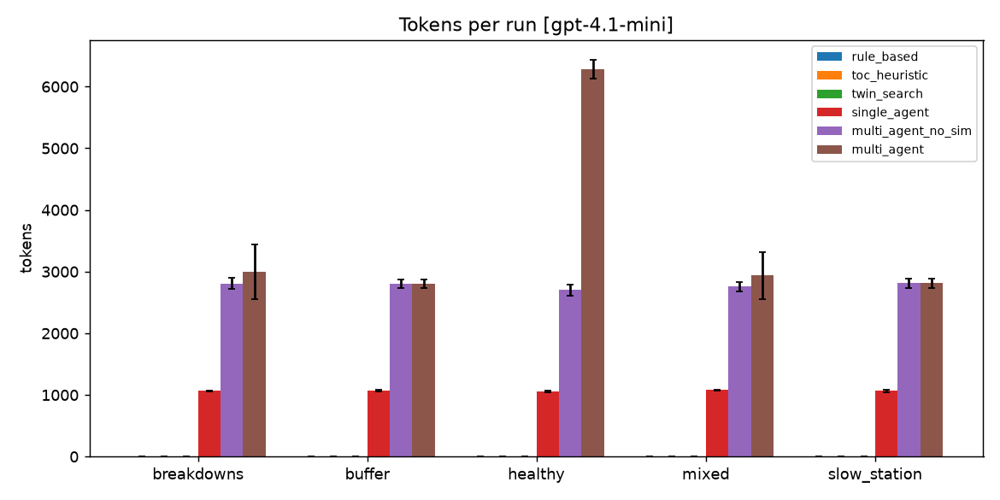
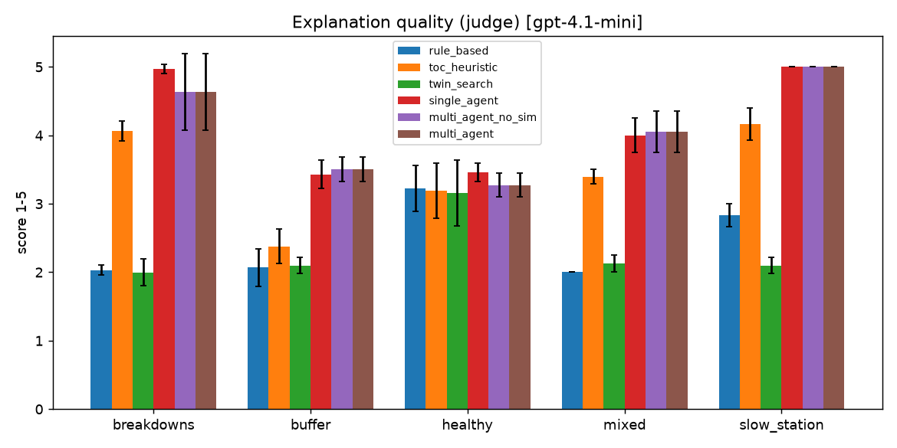
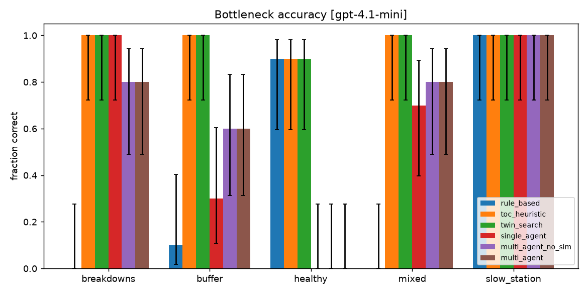
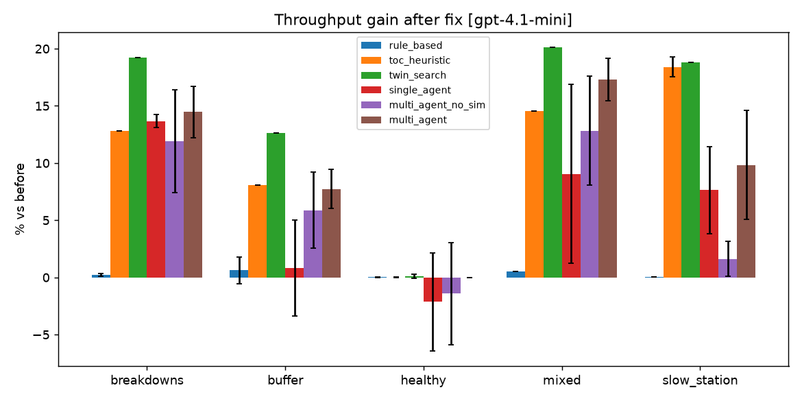
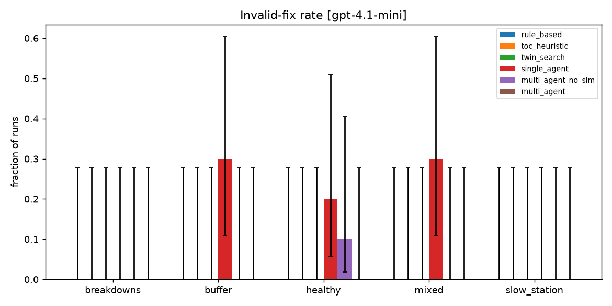
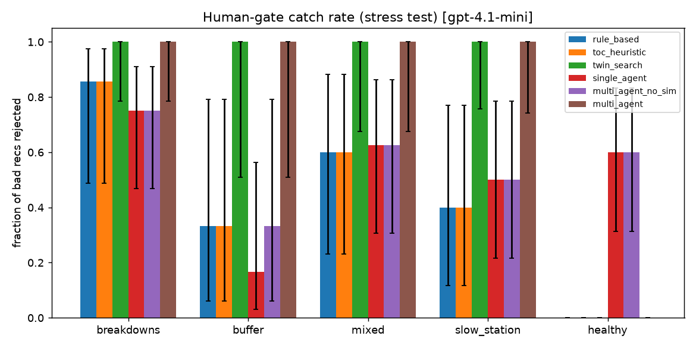

# Agentic Digital Twin for Shop-Floor Performance

**Evaluation basis:** real large-language-model run using OpenAI `gpt-4.1-mini` (Chat Completions, JSON mode, default sampling), 10 observation seeds per cell, 6 systems, 5 scenarios, 6 experiment arms (1,800 pipeline runs and 2,244 gate reviews in total), generated 2026-11-15. This report is self-contained: every parameter, definition, table and figure needed to understand and assess the work is included in the document itself.

---

## 1. Executive summary

This project builds and evaluates a multi-agent large-language-model (LLM) system that supervises a simulated five-station production line. The system monitors the line, diagnoses throughput loss, **tests candidate fixes inside a digital twin of the line**, and recommends a fix to a human supervisor only if the twin shows a measurable gain. The governing principle is **verify before act**: nothing reaches the supervisor without twin evidence, and nothing is applied without human approval.

Six systems were compared on five fault scenarios (including a healthy control) over 10 seeds each, using a real LLM. The main findings, for the four fault scenarios unless stated otherwise, are:

1. **Verification works.** The full multi-agent system never applied an ineffective or harmful fix (0% of runs, 95% CI [0, 8.8]) and never acted on the healthy line (0% false alarms). The identical agents without the Simulation step applied an ineffective fix in 40% of runs and acted on the healthy line in 100% of runs. The paired throughput-gain advantage of simulating first is **+4.28 percentage points** (95% CI [+2.75, +5.94]).
2. **Multi-agent diagnosis is not detectably more accurate than a single agent.** Bottleneck accuracy was 80.0% against 75.0%; the paired difference of +5.0 points has a 95% CI of [-10, +20]. The multi-agent design costs about 2.7 times the tokens (2,888 against 1,069) and 3.1 times the LLM calls.
3. **The human gate can only catch harmful-but-valid fixes when it is shown trustworthy twin evidence.** The default simulated gate caught 100% of bad recommendations from twin-verified systems but 0% of harmful-but-valid fixes from systems without twin evidence. When the evidence was forged, the trusting gate's catch rate fell to 63%. A gate that re-simulates every fix independently restored 100% in every system.
4. **The LLM is not what produces the throughput gain.** Exhaustive non-LLM search over the twin gained more throughput than the multi-agent system (17.7% against 12.3%; paired difference -5.35 points, CI [-6.76, -3.95]), and a simple Theory-of-Constraints heuristic was statistically indistinguishable from it (13.5% against 12.3%). The multi-agent system's distinctive contribution is a diagnosis with a readable explanation (judge score 4.30 out of 5, against 2.08 for exhaustive search and 3.50 for the heuristic), at roughly three LLM calls per run.

All results are obtained inside a simulation in which the twin is both the world and the verifier. They show that the verify-before-act mechanism works as designed; they do not measure behaviour on a real plant (Section 9).

---

## 2. Background and research questions

A production supervisor who sees output fall needs to know why, and what to change, without having to trust an unverified AI suggestion. Language models can propose plausible but harmful changes. This project tests whether forcing every proposal through a simulation, a hard safety schema and a human approval step produces recommendations that are better and safer than those of an LLM acting alone.

The study addresses three research questions and one extension:

- **RQ1.** Does a multi-agent design find the true bottleneck more accurately than a single LLM agent?
- **RQ2.** Does simulating fixes before recommending them improve recommendation quality?
- **RQ3.** How often does the human gate catch a harmful or invalid recommendation?
- **Extension.** Does the multi-agent system beat strong non-LLM baselines, and does the gate need to trust the evidence it is shown?

Scope: everything is simulated. The study does not include real PLC or OPC UA connectivity, computer vision, multi-plant scheduling or proprietary plant data.

---

## 3. System description

### 3.1 The digital twin

The twin is a discrete-event simulation of a serial production line with five stations and four buffers between them. Station *i* pulls a part from the upstream buffer, processes it, and pushes it to the downstream buffer; if the downstream buffer is full the station is blocked after service. Raw material before station 1 is unlimited and the sink after station 5 is unbounded. Each station and each source of randomness (cycle time, failures) has its own independently seeded random stream, so two configurations simulated with the same seed experience the same random draws wherever their behaviour coincides (common random numbers). This sharply reduces the variance of before/after comparisons.

Key modelling parameters (illustrative, in the style of textbook line-balancing examples; no proprietary data):

| Item | Value |
|---|---|
| Stations | 5, mean cycle times 60, 62, 63, 61 and 60 s |
| Cycle-time distribution | lognormal, coefficient of variation 0.25 (0.5 at station 3 in the buffer scenario) |
| Failures | exponential in operating time (a station cannot fail while starved or blocked); healthy mean time between failures (MTBF) 7,200 s |
| Repairs | exponential, healthy mean time to repair (MTTR) 180 s |
| Buffers | capacity 5 units each in the healthy line; blocking after service |
| Shift | 8 simulated hours, starting from an empty line (no warm-up trimming; the shared ramp-up cancels in gain calculations) |
| Healthy output | about 410 units per shift |

Key performance indicators (KPIs) are computed from 60-second cumulative snapshots: throughput, per-station utilisation and blocked, starved and down fractions, breakdown counts, mean buffer levels and work in progress. A structured event log records breakdown starts and ends and blocked and starved periods.

The twin was validated by automated tests: effective capacity must not exceed the analytic bound (cycle time divided by availability, with availability = MTBF / (MTBF + MTTR)) by more than 3% over an 8-replication average, and Little's law must hold within 5% on a 40-shift run.

### 3.2 Fault scenarios and ground truth

Five scenarios were defined, each with a known ground truth that the agents never see:

| Scenario | Definition | Ground truth |
|---|---|---|
| healthy | no fault | no fault |
| slow_station | station 2 cycle time raised to 95 s | station 2 |
| breakdowns | station 4 MTBF 900 s, MTTR 300 s | station 4 |
| buffer | buffer after station 2 limited to capacity 1; station 2 MTBF 1,500 s, MTTR 360 s; station 3 cycle-time CV 0.5 | station 2 (the station that owns the undersized buffer) |
| mixed | station 4 MTBF 800 s, MTTR 400 s (primary fault) plus station 2 at 75 s (secondary) | station 4 (lowest analytic effective capacity, asserted by tests) |

Analytic effective capacity ignores buffering, so it is used only to label the slow-station, breakdown and mixed scenarios.

### 3.3 Typed-action safety layer

Agents may only propose three kinds of typed action. Each action is a strictly validated record: unknown types, extra fields or wrong types are rejected with a logged reason. Constraints are checked against the current line configuration before an action is simulated or applied, and a valid action produces a modified copy of the configuration rather than changing it in place. Every path that can change the line, including the baselines and the human gate, goes through this layer.

| Action | Constraint |
|---|---|
| Add buffer | stations 1 to 4 only; adds 1 to 5 slots; total capacity capped at 12 |
| Rebalance task | adjacent stations only; fraction in (0, 0.30]; moves that fraction of the source station's mean cycle time to the destination, conserving total work |
| Change maintenance | only stations with a failure model; MTBF multiplier in [1, 2]; MTTR multiplier in [0.5, 1]; improvements only, no-ops rejected |

The limits are illustrative engineering bounds, not derived from a real plant.

### 3.4 The verify-before-act agent loop

The agent workflow is a graph with a human gate:

```
START -> monitor -> diagnosis -+-> (no fault) ------------------------------> finalize
                     ^         +-> candidates (Simulation) -+-> gate -+-> apply -> finalize
                     |                                      |         |
                     +---- re-diagnose (no viable fix) -----+         |
                     +---- re-diagnose (gate rejected) ---------------+
                          (cap: 3 diagnosis rounds -> finalize)
```

1. **Monitor.** Reads one simulated shift (KPIs plus an event summary) and flags anomalies. It sees engineered standard cycle times and current buffer capacities, but never the scenario label, the failure parameters or the ground truth. "Normal output" is the healthy line's mean throughput over 5 fixed reference seeds.
2. **Diagnosis.** Names the bottleneck station and fault type with an explanation and a confidence. After a rejected round it receives feedback (the rejected action, or "no viable fix" for a station) and must revise.
3. **Simulation.** Takes the LLM's candidate fixes (up to 5), validates each against the typed schema, runs every valid one over 8 seeded replications paired with the unmodified line, and passes only fixes whose mean gain is at least 2% and whose one-sided paired t-test gives p below 0.05. Results are ranked and only the top passing fix is recommended.
4. **Supervisor gate.** Approves or rejects the recommendation. In batch experiments a simulated approver plays this role; in the interactive supervisor interface a real person does.

Only an approved fix is applied, and it is re-validated first. The loop is capped at 3 diagnosis rounds; a round that yields no verified fix also counts toward the cap, and re-diagnosis skips stations previously found unfixable. An ablation replaces the Simulation step with "take the first constraint-valid proposal, unverified".

### 3.5 The gate

- **Trusting (default) approver.** Sees only the evidence presented. With twin evidence it approves if and only if the presented gain is at least 2%. Without evidence (the ablation systems and baselines) it can only check constraint validity, so a harmful but valid fix is approved. In stress experiments it injects a bad recommendation with a configured probability. An injected bad fix is either invalid (a buffer added after the last station) or harmful (30% of a neighbour's work moved onto the diagnosed bottleneck).
- **Independent approver.** Ignores presented evidence entirely. It validates the action, then re-simulates it on its own seeds with the same test used by the Simulation step (8 paired replications, 2% gain threshold, alpha 0.05) and decides on that alone. Fixes with no evidence are re-simulated too, so the gate rather than the proposer is the verifier. It uses the same twin as the proposer, so it removes selection bias and forged or stale evidence, but not model mismatch. Cost: 16 extra twin simulations per gate review.
- **Forged-evidence option.** An injected bad fix carries the real fix's evidence, as if the numbers were stale or fabricated. It only applies to systems that present evidence.

### 3.6 Supervisor interface

A web dashboard lets a person run the pipeline to the gate, inspect KPIs, findings, the candidate table (with before and after throughput, gain, confidence interval and p-value for each fix), and the agent trace, and then approve or reject. A rejection sends the loop back to Diagnosis for another round. A switch turns the Simulation agent off to show the no-evidence warning that motivates RQ2. The interface and the automated test suite (161 offline tests, all passing at the time of writing) were exercised with a rule-based stand-in for the LLM; every output produced that way is labelled as mock. No result in this report comes from mock mode.

### 3.7 LLM layer

All LLM calls go through one client that provides an on-disk cache keyed by model, system prompt and user prompt (so reruns are reproducible and free), token counting, exponential-backoff retries (1, 2, 4 and 8 s) on rate-limit, connection and server errors, and one repair re-ask when the reply is not valid JSON. A "step" is one LLM call, including cache hits and repair re-asks; tokens from cache hits are still counted as what a fresh run would spend. No sampling parameters were set. The same model also served as the judge for explanation quality.

---

## 4. Systems compared

Six systems face the same gate, the same typed-action validator and the same 3-round cap. All act only when throughput drops by at least 5%, so a healthy line is not penalised for a false alarm.

| System | Description |
|---|---|
| `rule_based` | No LLM, no twin. Bottleneck is the station with the highest busy fraction (ignoring downtime); the fix adds 3 buffer slots after it (before it if it is the last station). One gate round. A deliberately naive floor. |
| `toc_heuristic` | No LLM, no twin. Theory-of-Constraints rules on the observed KPIs. The constraint is the station with the highest utilisation plus downtime. If its measured cycle time exceeds 1.15 times standard, rebalance 20% of its work to the less-active adjacent station; else if it is down more than 8% of the shift and has a failure model, improve maintenance (MTBF x1.5, MTTR x0.75); else add 3 buffer slots before it. Thresholds were fixed in advance and not tuned on the scenarios. |
| `twin_search` | No LLM and no diagnosis. Enumerates a coarse grid of every action the validator allows (buffer sizes 1, 3 and 5 after each station; rebalance fractions 0.1, 0.2 and 0.3 in both directions between adjacent stations; five MTBF and MTTR multiplier pairs per station with a failure model), tests each with the Simulation step's own paired-replication test, and offers verified fixes best-first to the gate. About 496 twin simulations per fault run. No multiple-comparison correction is applied. |
| `single_agent` | One LLM call returns a diagnosis plus one typed action; no simulation. It receives validator and gate rejections as feedback (one extra LLM step each) and may retry up to the cap. |
| `multi_agent_no_sim` | The full agent graph with the Simulation step replaced by taking the first constraint-valid proposal, unverified (ablation). |
| `multi_agent` | The full verify-before-act graph. |

---

## 5. Experimental method

### 5.1 Design

The grid is 6 systems x 5 scenarios x 10 observation seeds, run under six experiment arms that share the same seeds and the same injection draws:

| Arm | Gate | Bad recommendations injected | Purpose |
|---|---|---|---|
| clean | trusting | never | RQ1, RQ2 |
| stress | trusting | probability 0.5 per review | RQ3 |
| clean_indep | independent | never | cost of independence on good fixes |
| stress_indep | independent | probability 0.5 | honest evidence, independent gate |
| stress_forged | trusting | probability 0.5, evidence forged | stale or fabricated evidence |
| stress_forged_indep | independent | probability 0.5, evidence forged | independent gate under forgery |

Each arm contains 300 runs (1,800 in total). Injection draws are seeded per scenario and seed and are identical across systems, so all systems face the same injections.

### 5.2 Settings and seed allocation

Simulation step: 8 replications, minimum gain 2.0%, alpha 0.05; loop cap 3 diagnosis rounds; at most 5 candidates per round. To keep verification honest, each role uses its own disjoint block of random seeds:

| Purpose | Seeds |
|---|---|
| Observation (the shift the agents see) | 1 to 10 |
| Reference "normal output" | 100 to 104 |
| Simulation step (verification) | 1000 to 1007 |
| Scoring of final configurations | 2000 to 2019 (20 replications) |
| Independent gate | 3000 onward |

Because fixes are scored on seeds that no agent or gate used, a fix that merely got lucky in verification shows up as ineffective in scoring.

### 5.3 Metrics

- **Bottleneck accuracy.** The station named by the first diagnosis equals the seeded station. On the healthy line, correct means reporting no fault. Fault-type accuracy accepts "breakdowns" or "slow_station" for the mixed scenario; the rule-based and exhaustive-search systems give no fault type and are excluded.
- **Throughput gain.** Mean throughput of the final configuration against the scenario configuration over the 20 scoring replications, as a percentage; 0 when nothing is applied. Reported as a mean over runs, so runs with no action pull it down.
- **Invalid or harmful fix.** A non-injected recommendation that reached the gate is invalid if it breaks the schema or constraints, and harmful if independent replications show a throughput loss above 1%.
- **Ineffective fix.** An applied fix whose independent gain is below 2% (any action on the healthy line counts).
- **Gate catch rate.** Among gate reviews of bad recommendations (invalid or harmful by independent evaluation, injected or not), the share rejected. Computed in stress arms only.
- **Cost.** LLM steps and tokens per run, from a usage meter (judge calls excluded). For exhaustive search, twin simulations.
- **Explanation quality.** An LLM judge scores the first diagnosis's explanation for correctness, evidence and clarity on a 1 to 5 scale (overall is the mean). The judge sees the reference label.

### 5.4 Statistics

Wilson intervals for proportions, t-intervals for means, and a paired bootstrap (2,000 resamples) for differences between systems over the 40 shared (scenario, seed) pairs from the four fault scenarios. All intervals are 95%. A difference is called detectable only when its interval excludes zero.

---

## 6. Results

### 6.1 Overall results, fault scenarios, clean arm

| System | Bottleneck acc. % | Fault-type acc. % | Throughput gain % | Invalid/harmful % | Ineffective % | LLM steps | Tokens | Explanation (1-5) |
|---|---|---|---|---|---|---|---|---|
| rule_based | 27.5 [16.1, 42.8] | n/a | 0.4 [0.1, 0.6] | 0.0 [0.0, 8.8] | 97.5 [87.1, 99.6] | 0 | 0 | 2.23 [2.10, 2.37] |
| toc_heuristic | 100.0 [91.2, 100.0] | 75.0 [59.8, 85.8] | 13.5 [12.3, 14.7] | 0.0 [0.0, 8.8] | 0.0 [0.0, 8.8] | 0 | 0 | 3.50 [3.26, 3.75] |
| twin_search | 100.0 [91.2, 100.0] | n/a | 17.7 [16.7, 18.6] | 0.0 [0.0, 8.8] | 0.0 [0.0, 8.8] | 0 | 0 | 2.08 [2.02, 2.14] |
| single_agent | 75.0 [59.8, 85.8] | 75.0 [59.8, 85.8] | 7.8 [5.2, 10.4] | 15.0 [7.1, 29.1] | 25.0 [14.2, 40.2] | 1.0 | 1,069 [1,063, 1,075] | 4.35 [4.12, 4.58] |
| multi_agent_no_sim | 80.0 [65.2, 89.5] | 72.5 [57.2, 83.9] | 8.1 [5.9, 10.2] | 0.0 [0.0, 8.8] | 40.0 [26.3, 55.4] | 3.0 | 2,795 [2,759, 2,831] | 4.30 [4.06, 4.53] |
| multi_agent | 80.0 [65.2, 89.5] | 72.5 [57.2, 83.9] | 12.3 [10.6, 14.1] | 0.0 [0.0, 8.8] | 0.0 [0.0, 8.8] | 3.1 [3.0, 3.2] | 2,888 [2,758, 3,018] | 4.30 [4.06, 4.53] |

The two multi-agent variants share the same Monitor and Diagnosis steps, and their first-diagnosis metrics (accuracy, fault type, explanation) are identical; they differ only after diagnosis.





### 6.2 Bottleneck accuracy (%) by scenario

| System | breakdowns | buffer | healthy | mixed | slow_station |
|---|---|---|---|---|---|
| rule_based | 0.0 [0.0, 27.8] | 10.0 [1.8, 40.4] | 90.0 [59.6, 98.2] | 0.0 [0.0, 27.8] | 100.0 [72.2, 100.0] |
| toc_heuristic | 100.0 [72.2, 100.0] | 100.0 [72.2, 100.0] | 90.0 [59.6, 98.2] | 100.0 [72.2, 100.0] | 100.0 [72.2, 100.0] |
| twin_search | 100.0 [72.2, 100.0] | 100.0 [72.2, 100.0] | 90.0 [59.6, 98.2] | 100.0 [72.2, 100.0] | 100.0 [72.2, 100.0] |
| single_agent | 100.0 [72.2, 100.0] | 30.0 [10.8, 60.3] | 0.0 [0.0, 27.8] | 70.0 [39.7, 89.2] | 100.0 [72.2, 100.0] |
| multi_agent_no_sim | 80.0 [49.0, 94.3] | 60.0 [31.3, 83.2] | 0.0 [0.0, 27.8] | 80.0 [49.0, 94.3] | 100.0 [72.2, 100.0] |
| multi_agent | 80.0 [49.0, 94.3] | 60.0 [31.3, 83.2] | 0.0 [0.0, 27.8] | 80.0 [49.0, 94.3] | 100.0 [72.2, 100.0] |

The three LLM systems score 0% on the healthy line because they always report a fault. Only the Simulation step stops that from becoming an action (Section 6.5). The buffer scenario is the hardest for the LLM systems (30% to 60%), while both non-LLM baselines that use measured utilisation and downtime reach 100% there.



### 6.3 Throughput gain (%) by scenario

| System | breakdowns | buffer | healthy | mixed | slow_station |
|---|---|---|---|---|---|
| rule_based | 0.2 [0.1, 0.4] | 0.6 [-0.5, 1.8] | 0.0 [-0.0, 0.1] | 0.5 [0.5, 0.5] | 0.1 [0.1, 0.1] |
| toc_heuristic | 12.8 [12.8, 12.8] | 8.1 [8.1, 8.1] | 0.0 [-0.0, 0.0] | 14.6 [14.6, 14.6] | 18.4 [17.5, 19.3] |
| twin_search | 19.2 [19.2, 19.2] | 12.7 [12.7, 12.7] | 0.1 [-0.1, 0.3] | 20.1 [20.1, 20.1] | 18.8 [18.8, 18.8] |
| single_agent | 13.7 [13.1, 14.2] | 0.8 [-3.4, 5.0] | -2.1 [-6.4, 2.2] | 9.1 [1.2, 16.9] | 7.6 [3.8, 11.5] |
| multi_agent_no_sim | 11.9 [7.4, 16.4] | 5.9 [2.5, 9.2] | -1.4 [-5.9, 3.0] | 12.8 [8.1, 17.6] | 1.6 [0.1, 3.2] |
| multi_agent | 14.5 [12.2, 16.7] | 7.7 [6.0, 9.5] | 0.0 [0.0, 0.0] | 17.3 [15.5, 19.2] | 9.8 [5.1, 14.6] |

Zero-width intervals for the deterministic baselines indicate that they produced the same gain on every seed of a scenario.



### 6.4 Invalid, harmful and ineffective fixes

An invalid or harmful fix breaks the typed-action constraints or loses more than 1% throughput on independent replications. An ineffective fix is an applied fix with independent gain below 2%.

**Invalid or harmful fix rate (%) by scenario**

| System | breakdowns | buffer | healthy | mixed | slow_station |
|---|---|---|---|---|---|
| rule_based | 0.0 [0.0, 27.8] | 0.0 [0.0, 27.8] | 0.0 [0.0, 27.8] | 0.0 [0.0, 27.8] | 0.0 [0.0, 27.8] |
| toc_heuristic | 0.0 [0.0, 27.8] | 0.0 [0.0, 27.8] | 0.0 [0.0, 27.8] | 0.0 [0.0, 27.8] | 0.0 [0.0, 27.8] |
| twin_search | 0.0 [0.0, 27.8] | 0.0 [0.0, 27.8] | 0.0 [0.0, 27.8] | 0.0 [0.0, 27.8] | 0.0 [0.0, 27.8] |
| single_agent | 0.0 [0.0, 27.8] | 30.0 [10.8, 60.3] | 20.0 [5.7, 51.0] | 30.0 [10.8, 60.3] | 0.0 [0.0, 27.8] |
| multi_agent_no_sim | 0.0 [0.0, 27.8] | 0.0 [0.0, 27.8] | 10.0 [1.8, 40.4] | 0.0 [0.0, 27.8] | 0.0 [0.0, 27.8] |
| multi_agent | 0.0 [0.0, 27.8] | 0.0 [0.0, 27.8] | 0.0 [0.0, 27.8] | 0.0 [0.0, 27.8] | 0.0 [0.0, 27.8] |

**Ineffective fix rate (%) by scenario**

| System | breakdowns | buffer | healthy | mixed | slow_station |
|---|---|---|---|---|---|
| rule_based | 100.0 [72.2, 100.0] | 90.0 [59.6, 98.2] | 10.0 [1.8, 40.4] | 100.0 [72.2, 100.0] | 100.0 [72.2, 100.0] |
| toc_heuristic | 0.0 [0.0, 27.8] | 0.0 [0.0, 27.8] | 10.0 [1.8, 40.4] | 0.0 [0.0, 27.8] | 0.0 [0.0, 27.8] |
| twin_search | 0.0 [0.0, 27.8] | 0.0 [0.0, 27.8] | 10.0 [1.8, 40.4] | 0.0 [0.0, 27.8] | 0.0 [0.0, 27.8] |
| single_agent | 0.0 [0.0, 27.8] | 70.0 [39.7, 89.2] | 100.0 [72.2, 100.0] | 30.0 [10.8, 60.3] | 0.0 [0.0, 27.8] |
| multi_agent_no_sim | 20.0 [5.7, 51.0] | 40.0 [16.8, 68.7] | 100.0 [72.2, 100.0] | 20.0 [5.7, 51.0] | 80.0 [49.0, 94.3] |
| multi_agent | 0.0 [0.0, 27.8] | 0.0 [0.0, 27.8] | 0.0 [0.0, 27.8] | 0.0 [0.0, 27.8] | 0.0 [0.0, 27.8] |



### 6.5 False-alarm actions on the healthy line (%)

| System | Runs that acted on the healthy line |
|---|---|
| rule_based | 10.0 [1.8, 40.4] |
| toc_heuristic | 10.0 [1.8, 40.4] |
| twin_search | 10.0 [1.8, 40.4] |
| single_agent | 100.0 [72.2, 100.0] |
| multi_agent_no_sim | 100.0 [72.2, 100.0] |
| multi_agent | 0.0 [0.0, 27.8] |

The 10% false-alarm rate of the three non-LLM systems corresponds to one run out of ten on the healthy line.

### 6.6 Human-gate catch rate, stress arm

| System | Bad recommendations reaching the gate | Caught % | 95% CI |
|---|---|---|---|
| rule_based | 20 | 60.0 | [38.7, 78.1] |
| toc_heuristic | 20 | 60.0 | [38.7, 78.1] |
| twin_search | 38 | 100.0 | [90.8, 100.0] |
| single_agent | 44 | 56.8 | [42.2, 70.3] |
| multi_agent_no_sim | 41 | 61.0 | [45.7, 74.3] |
| multi_agent | 37 | 100.0 | [90.6, 100.0] |

Catch rate split by why the recommendation was bad:

| System | Reason | Bad recommendations | Caught % | 95% CI |
|---|---|---|---|---|
| multi_agent | harmful | 16 | 100.0 | [80.6, 100.0] |
| multi_agent | invalid | 21 | 100.0 | [84.5, 100.0] |
| multi_agent_no_sim | harmful | 16 | 0.0 | [0.0, 19.4] |
| multi_agent_no_sim | invalid | 25 | 100.0 | [86.7, 100.0] |
| rule_based | harmful | 8 | 0.0 | [0.0, 32.4] |
| rule_based | invalid | 12 | 100.0 | [75.7, 100.0] |
| single_agent | harmful | 19 | 0.0 | [0.0, 16.8] |
| single_agent | invalid | 25 | 100.0 | [86.7, 100.0] |
| toc_heuristic | harmful | 8 | 0.0 | [0.0, 32.4] |
| toc_heuristic | invalid | 12 | 100.0 | [75.7, 100.0] |
| twin_search | harmful | 16 | 100.0 | [80.6, 100.0] |
| twin_search | invalid | 22 | 100.0 | [85.1, 100.0] |

Share of stress runs in which a bad (invalid or harmful) fix was actually applied: rule_based 20%, toc_heuristic 20%, twin_search 0%, single_agent 38%, multi_agent_no_sim 30%, multi_agent 0%.



### 6.7 Does the gate need to trust the evidence? Independent re-simulation

Catch rate over bad recommendations reaching the gate, across the four stress arms (number of bad recommendations in brackets):

| System | Honest evidence, trusting gate | Honest evidence, independent gate | Forged evidence, trusting gate | Forged evidence, independent gate |
|---|---|---|---|---|
| rule_based | 60% (n=20) | 100% (n=20) | 60% (n=20) | 100% (n=20) |
| toc_heuristic | 60% (n=20) | 100% (n=20) | 60% (n=20) | 100% (n=20) |
| twin_search | 100% (n=38) | 100% (n=38) | 63% (n=30) | 100% (n=38) |
| single_agent | 57% (n=44) | 100% (n=75) | 57% (n=44) | 100% (n=75) |
| multi_agent_no_sim | 61% (n=41) | 100% (n=70) | 61% (n=41) | 100% (n=70) |
| multi_agent | 100% (n=37) | 100% (n=38) | 63% (n=30) | 100% (n=38) |

Cost of independence on good fixes (clean arms, fault scenarios, no bad recommendations injected):

| System | Gain %, trusting gate | Fixes applied | Gain %, independent gate | Fixes applied |
|---|---|---|---|---|
| rule_based | 0.4 [0.1, 0.6] | 100% | 0.1 [-0.1, 0.4] | 2% |
| toc_heuristic | 13.5 [12.3, 14.7] | 100% | 13.5 [12.3, 14.7] | 100% |
| twin_search | 17.7 [16.7, 18.6] | 100% | 17.7 [16.7, 18.6] | 100% |
| single_agent | 7.8 [5.2, 10.4] | 100% | 9.7 [7.8, 11.7] | 82% |
| multi_agent_no_sim | 8.1 [5.9, 10.2] | 100% | 10.2 [8.4, 12.0] | 88% |
| multi_agent | 12.3 [10.6, 14.1] | 100% | 12.3 [10.6, 14.1] | 100% |

Reading. With forged evidence the trusting gate can only catch invalid actions, so a harmful but valid fix that arrives with good-looking numbers escapes (63% caught). The independent gate never uses those numbers and catches it. Independence raised the mean gain of the unverified LLM systems because it rejects their bad fixes, and left twin-verified systems unchanged. The price is 16 extra twin simulations per review, and the gate itself becomes the verifier, so differences in fix safety between systems shrink under it. Because the re-simulation uses the same twin as the proposer, it removes selection bias and forgery but not model mismatch.

---

## 7. Answers to the research questions

**RQ1. Does a multi-agent design find the true bottleneck more accurately than a single LLM agent?** Not detectably. Bottleneck accuracy on the fault scenarios was 80.0% [65.2, 89.5] for the multi-agent system and 75.0% [59.8, 85.8] for the single agent. The paired difference (multi minus single) is +5.0 points, 95% CI [-10.0, +20.0], n = 40 pairs, so the interval includes zero and is compatible with both a meaningful advantage and a meaningful disadvantage. Both beat the rule-based baseline by +52.5 points (CI [+37.5, +67.5]). The multi-agent design cost 3.10 [2.96, 3.24] LLM steps and 2,888 [2,758, 3,018] tokens per run against 1.00 steps and 1,069 [1,063, 1,075] tokens for the single agent.

**RQ2. Does simulating fixes before recommending them improve recommendation quality?** Yes. Comparing the same agents with and without the Simulation step on the fault scenarios: throughput gain +4.28 points (CI [+2.75, +5.94]); ineffective-fix rate -0.40 (CI [-0.55, -0.25]); invalid-or-harmful rate no detectable difference (0 against 0 in the clean arm). Against the single agent, the gain difference is +4.54 points (CI [+2.11, +7.10]). One caveat applies: the Simulation step picks the best-measured candidate from the same proposal list, so part of the gain reflects selection among candidates, not better proposals.

**Extension. Does the multi-agent system beat strong non-LLM baselines?** No on throughput, and the interval for one baseline excludes zero:

| Baseline | Throughput gain, multi_agent minus baseline | Ineffective-fix rate, multi_agent minus baseline |
|---|---|---|
| toc_heuristic | -1.13 points (CI [-3.05, +0.71]): no detectable difference | +0.00 (CI [+0.00, +0.00]): no detectable difference |
| twin_search | -5.35 points (CI [-6.76, -3.95]): lower | +0.00 (CI [+0.00, +0.00]): no detectable difference |

Exhaustive twin search gains more than the multi-agent system, so on this grid the proposer's shortlist (at most 5 candidates), not the twin, limits what the multi-agent system achieves; the LLM roles are not what produces the gain. Theory-of-Constraints rules match it statistically. What the multi-agent system adds is a diagnosis and a readable explanation (judge score 4.30 against 2.08 for exhaustive search and 3.50 for the heuristic), which the search does not produce, and about 3 LLM calls per run instead of about 496 twin simulations. The heuristic misreads the buffer scenario as a breakdown problem; this is reported as observed.

**RQ3. How often does the gate catch a harmful or invalid recommendation?** Overall catch rates over bad recommendations that reached the gate were 100% for twin_search and multi_agent, 61% for multi_agent_no_sim, 60% for rule_based and toc_heuristic, and 57% for single_agent. Invalid recommendations were caught 100% of the time by every system, because constraint checking is deterministic. Harmful-but-valid recommendations were caught 100% of the time only when twin evidence was shown, and 0% otherwise. This follows from how the simulated approver is defined, so the harmful row verifies a mechanism and is not an independent finding about supervisors. Under forged evidence the trusting gate fell to 63% and an independent re-simulating gate held at 100%. A real supervisor's catch rate requires human data.

---

## 8. Discussion

**Where the value comes from.** The consistent benefit in this study is the combination of a hard safety schema and a verification step, not the language model itself. The schema removed every invalid fix from the systems that passed through it, and verification removed every ineffective or harmful fix and every false alarm. These properties hold regardless of how good the proposer is, which is why they are more robust than any claim about LLM diagnosis quality.

**What the LLM does contribute.** The LLM systems produced the most readable explanations by a wide margin (judge score about 4.3 against 2.1 to 3.5), and they diagnosed the breakdown and slow-station scenarios as well as the baselines did. They struggled on the buffer scenario and on the healthy line, where they always reported a fault.

**Why exhaustive search wins on throughput.** On a five-station line with a three-action vocabulary the full action grid is small enough to enumerate (about 496 simulations per fault run). An LLM proposing at most five candidates can only match that by luck. The comparison would shift on larger lines where enumeration is infeasible and a good proposer is needed to focus the search.

**Practical reading.** If the aim is only throughput on a small, well-modelled line, a verified search is enough. If the aim is a trustworthy assistant that explains itself, accepts supervisor feedback and can never recommend an unverified or unsafe change, the verify-before-act wrapper is what matters, and it should be paired with an independent verifier when evidence can be stale or forged.

---

## 9. Limitations and threats to validity

- **No model mismatch.** The twin is both the world the agents observe and the verifier they use, so verified gains are real inside the simulation by definition. A real plant adds a simulation-to-reality gap. The independent gate removes selection bias and forgery but not mismatch, and no mis-specified-twin experiment was run for the real-LLM results.
- **Synthetic scenarios.** Five author-chosen scenarios; ground truth is exact only because the faults are seeded; line parameters are illustrative, not taken from a real plant or published data set.
- **Small sample.** Ten seeds per cell gives wide intervals. The RQ1 result means "not detected", not "no difference": the interval [-10, +20] points is compatible with a meaningful advantage or disadvantage.
- **Simulated supervisor.** The batch approver is rule-based, never errs and is never fooled by plausible text. RQ3 describes the mechanism, not human behaviour.
- **Single model.** Only `gpt-4.1-mini` with default sampling was evaluated, and no repeated runs with different sampling were made. Results may differ for other models.
- **Explanation quality.** Scored by an LLM judge that sees the reference label, may favour fluent text, and was not validated against human scores. A blind, shuffled human-review sheet of 60 items (two seeds per system and scenario cell) was prepared but not scored.
- **Gain averaging.** Throughput gain is a mean over runs including those where no fix was applied (gain 0), which lowers the figures for systems that sometimes do nothing.
- **No multiple-comparison correction** in the Simulation step's test, matching the system as designed; lucky winners appear as ineffective fixes in scoring. The reported cost for exhaustive search is the uncached count.
- **Deterministic baselines.** Their zero-width intervals reflect identical actions across seeds, not unusually precise measurement.

---

## 10. Future work

1. Collect human scores for explanation quality and a real supervisor's approve and reject decisions through the dashboard.
2. Run mis-specified-twin experiments with the real LLM to measure simulation-to-reality degradation and the value of an independent gate under model mismatch.
3. Widen the candidate shortlist, or let the LLM guide a search over the action grid, to close the gap to exhaustive search.
4. Use more seeds and more models, including other providers, to tighten the RQ1 interval.
5. Add more scenarios, including published or real line data, and a larger line where exhaustive search is infeasible.

---

## 11. Conclusion

Forcing every proposed change through a strict action schema, a paired-replication simulation and a human gate removed all invalid, harmful and ineffective recommendations and all false alarms in this study, at about three LLM calls per run. It did not make the LLM diagnose more accurately than a single agent, and a non-LLM exhaustive search found larger gains on this small line. The mechanism is therefore best understood as a safety and accountability layer around any proposer, strengthened by an independent verifier when evidence cannot be trusted. Confirming these properties on a real plant, with real supervisors, remains open.

---

## Appendix A. Glossary

| Term | Meaning |
|---|---|
| Digital twin | Simulation of the production line used to test fixes before they are recommended |
| Throughput | Units finished per 8-hour shift |
| Bottleneck | The station limiting line output |
| MTBF / MTTR | Mean time between failures / mean time to repair |
| Typed action | A strictly validated, schema-checked change (add buffer, rebalance task, change maintenance) |
| Paired replications | Simulating the fix and the unmodified line on the same random seeds to cut variance |
| Gate | The approve or reject step before any fix is applied |
| Trusting gate | Decides from the evidence presented with the recommendation |
| Independent gate | Ignores presented evidence and re-simulates the fix on its own seeds |
| Harmful fix | A valid fix that lowers independent throughput by more than 1% |
| Ineffective fix | An applied fix whose independent gain is below 2% |
| Wilson / bootstrap interval | Confidence-interval methods for proportions and for paired differences |
